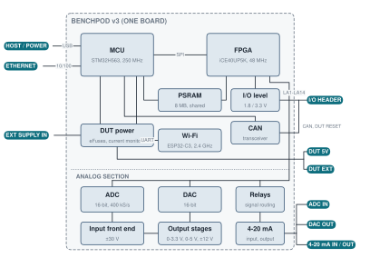
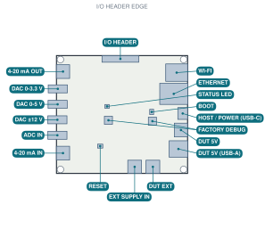
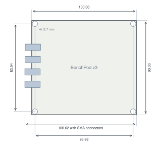

<!-- title: BenchPod v3 datasheet -->
<!-- output: BenchPod-v3-datasheet.pdf -->
<!-- footer: BenchPod v3 datasheet · Rev A · November 2026 · embeddedci.com -->

<div class="cover" markdown="1">
<div class="brand">EmbeddedCI</div>

# BenchPod v3

<div class="subtitle">Hardware-in-the-loop test instrument for embedded boards</div>
<div class="meta">Datasheet · Rev A · November 2026 · Single board, revisions v3-r1 and v3-r2</div>
</div>

<div class="columns" markdown="1">
<div markdown="1">

### Overview

BenchPod sits next to the embedded board under test (the DUT) and does what an engineer does at the bench: it powers the DUT, flashes its firmware, reads its console, and measures and drives its signals. Tests run on real hardware, started from a laptop, a CI pipeline or an AI agent, over Ethernet, Wi-Fi, USB or the EmbeddedCI cloud.

BenchPod v3 is a **single board** with both the digital section (power, flashing, logic analyzer, network) and the analog section (ADC, DAC, 4-20 mA). It is an evaluation board for electronics developers, supplied as a bare board assembly. The current BenchPod, with a digital board and an analog module, has its own datasheet.

### Which board this covers

The board revision is printed on the silkscreen, in the corner by the 4-20 mA IN terminal:

- **BenchPod v3-r1**
- **BenchPod v3-r2**

Where the two differ, this datasheet says so; the table in *Board revisions* lists every difference.

</div>
<div markdown="1">

### Key features

- **DUT power**: switched 5 V and external supply outputs, current monitoring
- **Flash and debug**: on-board CMSIS-DAP probe (SWD), works with OpenOCD targets
- **14-channel logic analyzer / GPIO** at 1.8 V or 3.3 V
- **Protocols**: UART, I2C (sensor emulation), SPI, CAN and CAN FD
- **16-bit ADC**, 400 kS/s, ±30 V, SMA input
- **16-bit DAC**, outputs 0-3.3 V, 0-5 V and ±12 V on SMA
- **4-20 mA** input and output
- **Network**: Ethernet, built-in Wi-Fi, USB, EmbeddedCI cloud
- **Software**: Python SDK with pytest, CLI, MCP server for AI agents, web app

</div>
</div>

## At a glance

| | |
|---|---|
| Power input | 5 V DC, USB-C, from a computer or USB-C power source |
| DUT power | Switched 5 V (2 A) and external 2.7-20 V (3 A) outputs, current monitoring |
| Logic analyzer / GPIO | 14 channels, 1.8 V or 3.3 V, up to 12 MS/s, 48 MS/s change capture |
| Protocols | SWD (CMSIS-DAP), UART, SPI, I2C sensor emulation, GPS emulation, CAN and CAN FD |
| ADC | 16-bit, 400 kS/s, ±30 V, SMA |
| DAC | 16-bit, 0-3.3 V, 0-5 V and ±12 V outputs on SMA, up to 889 kS/s |
| Current loop | 4-20 mA input and two-wire 4-20 mA output |
| Network | Ethernet 10/100, Wi-Fi 2.4 GHz (built in), USB, EmbeddedCI cloud |
| Size | 100 x 90 mm board, 106.6 mm wide with the SMA connectors |

## How it works

<figure>

<figcaption>Functional block diagram. Ports are shown with their names on the board edge.</figcaption>
</figure>

### Digital section

- **MCU** (STM32H563): runs the firmware. It handles the network (ETHERNET, Wi-Fi, the USB network adapter and the cloud connection) and executes the commands. It also switches and monitors DUT power, runs the CAN controller, drives DUT RESET and sets the analog relays.
- **FPGA** (iCE40UP5K): every LA channel on the I/O HEADER goes straight to an FPGA pin, through a 330 Ω series resistor and an ESD clamp. No pin has a fixed function. The FPGA implements logic analyzer capture, GPIO, timed pulses, UART, SPI, the SWD debug probe, and I2C sensor and GPS emulation, on whichever channels the wiring profile assigns. It also drives the ADC and DAC and the STATUS LED.
- **I/O level**: the FPGA's LA bank runs from a switched 1.8 V or 3.3 V supply. The channels are at the DUT's logic level directly, with no level shifters.
- **PSRAM** (8 MB): shared by the MCU and the FPGA. Deep captures stream into it, and recorded signals replay from it.
- **Wi-Fi**: an ESP32-C3 module with its own antenna, connected to the MCU. The pod's firmware installs and updates its image.
- **DUT power**: eFuses with current limits switch the DUT 5V and DUT EXT outputs. A monitor measures each output's current.

### Analog section

- **ADC IN**: a divider, buffer and differential driver feed a 16-bit SAR ADC with a 4.096 V reference. Input range ±30 V.
- **DAC**: on v3-r2, a quad 16-bit DAC with one channel per output: 0-3.3 V, 0-5 V, ±12 V, plus the channel for the 4-20 mA output. On v3-r1, one 16-bit DAC is switched to the selected output. On both, the firmware drives one voltage output at a time.
- **4-20 mA**: the input is a 249 Ω sense resistor read by the ADC. The output is a two-wire loop transmitter set by the DAC.
- **Relays** route the inputs and loop the outputs back to the ADC, for self-test and calibration.

<div class="page-break"></div>

## Ports

<figure class="board">

<figcaption>BenchPod v3, top view, I/O HEADER edge up. The same layout on v3-r1 and v3-r2; FACTORY DEBUG is shown as on v3-r2.</figcaption>
</figure>

| Port | Silkscreen | Connector | Function |
|---|---|---|---|
| HOST / POWER | USB IN | USB-C | 5 V power input and USB connection to the computer (network adapter, console, firmware update) |
| ETHERNET | | RJ45, 10/100 Mbit/s | Network connection to the LAN or the EmbeddedCI cloud |
| I/O HEADER | LA1, LA2 | 2x11 pin header, 2.54 mm | 14 logic analyzer / GPIO channels, CAN, DUT reset, reference voltages |
| DUT 5V | OUT (5V) | 2-pin screw terminal, 5.08 mm | Switched 5 V supply for the DUT |
| DUT 5V (USB-A) | OUT (5V) | USB-A | Same switched 5 V supply as DUT 5V, power only |
| EXT SUPPLY IN | TARGET IN | 2-pin screw terminal, 5.08 mm | External DUT supply input, 2.7-20 V |
| DUT EXT | OUT | 2-pin screw terminal, 5.08 mm | Switched external supply for the DUT |
| ADC IN | ±30V ADC | SMA | Analog input, ±30 V |
| DAC 0-3.3 V | 0-3V3 DAC | SMA | Analog output, 0-3.3 V |
| DAC 0-5 V | 0-5V DAC | SMA | Analog output, 0-5 V |
| DAC ±12 V | ±12V DAC | SMA | Analog output, ±12 V |
| 4-20 mA IN | 4-20mA IN | 2-pin screw terminal, 5.08 mm | Current loop measurement input |
| 4-20 mA OUT | 4-20mA OUT | 2-pin screw terminal, 5.08 mm | Two-wire 4-20 mA transmitter output |
| WI-FI | | On-board module antenna | Wi-Fi 2.4 GHz |
| STATUS LED | | RGB LED | Pod status |
| RESET, BOOT | | Push buttons | Restart the pod; enter firmware update mode |
| FACTORY DEBUG | | Unfitted footprints | Production use only |

Next to each SMA connector is a 2-pin test point with the same signal and GND, for a probe or a jumper wire.

The EXT SUPPLY IN silkscreen says 5V-20V; the input accepts 2.7-20 V.

<div class="page-break"></div>

## Pin assignments

### I/O HEADER

The I/O HEADER is a 2x11 vertical pin header with 2.54 mm pitch, on the top edge of the board. It has no shroud or key: LA1 and LA2 are marked on the silkscreen, at the end of the header nearest the SMA connectors. Odd pins are in one row and even pins in the other.

<div class="columns" markdown="1">
<div markdown="1">

| Pin | Signal | Pin | Signal |
|---|---|---|---|
| 1 | LA1 | 2 | LA2 |
| 3 | LA3 | 4 | LA4 |
| 5 | LA5 | 6 | LA6 |
| 7 | LA7 | 8 | LA8 |
| 9 | LA9 | 10 | LA10 |
| 11 | LA11 | 12 | LA12 |

</div>
<div markdown="1">

| Pin | Signal | Pin | Signal |
|---|---|---|---|
| 13 | LA13 | 14 | LA14 |
| 15 | GND | 16 | GND |
| 17 | +3.3 V out | 18 | +1.8 V out |
| 19 | CAN high | 20 | CAN low |
| 21 | LA_REF | 22 | DUT RESET |

</div>
</div>

- **LA1-LA14**: logic analyzer and GPIO channels. Any channel can carry UART, SWD, SPI, I2C or a GPIO; the wiring profile in the web app records which signal is on which channel.
- **LA_REF**: reference output at the selected I/O voltage (1.8 V or 3.3 V).
- **DUT RESET**: dedicated reset line to the DUT, used when flashing and by reset commands.
- **CAN high / CAN low**: CAN or CAN FD bus through an on-board transceiver, with a switchable termination.

Pins 1-22 carry the same signals as on the current BenchPod's 2x13 I/O HEADER, so a wiring profile works on both.

### Screw terminals

All screw terminals are fixed to the board, 5.08 mm pitch, for bare wire or ferrules. Pins are listed left to right, looking at the terminal from outside the board.

| Port | Left to right |
|---|---|
| DUT 5V | GND , + |
| EXT SUPPLY IN | GND , + (2.7-20 V) |
| DUT EXT | GND , + |
| 4-20 mA IN | GND , + (input) |
| 4-20 mA OUT | - (loop return) , + (to loop supply plus) |

<div class="note">

The 4-20 mA OUT minus terminal is not ground. The loop needs its own floating supply, and nothing in the loop may connect to the pod's ground.

</div>

### SMA connectors

The SMA center pin is the signal and the shell is the pod's ground. Top to bottom along the left edge: DAC 0-3.3 V, DAC 0-5 V, DAC ±12 V, ADC IN.

<div class="page-break"></div>

## Electrical characteristics

Typical values at 25 °C, with the pod powered from a 5 V USB-C supply.

<div class="keep" markdown="1">

### Power

| Parameter | Value |
|---|---|
| Supply input | 5 V DC via HOST / POWER (USB-C), protected by an eFuse. No power adapter is included: BenchPod runs from the computer's USB-C port |
| Current consumption | About 0.26 A idle, about 0.32 A with Wi-Fi connected; under 0.5 A with all functions running (DUT power not included) |
| DUT 5V output | 5 V from the input, switched, current limit about 2 A, shared with DUT 5V (USB-A). Together with the pod's own draw, limited by what the computer's USB-C port supplies (often 1.5 A or 3 A) |
| EXT SUPPLY IN | 2.7-20 V DC, for example 3.3 V, 12 V or 19 V. Below about 2.5 V the output stays off, so it cannot pass 1.8 V. Above about 21.8 V the output switches off |
| DUT EXT output | Switched EXT SUPPLY IN, current limit about 3 A |
| DUT current monitoring | On both DUT outputs: about 83 µA resolution on DUT 5V, 125 µA on DUT EXT |
| Analog supply | ±14 V for the ±12 V output and the ADC front end. v3-r1: on whenever the pod is powered. v3-r2: off at power-up, switched on by the firmware |

</div>
<div class="keep" markdown="1">

### Logic analyzer and GPIO

| Parameter | Value |
|---|---|
| Channels | 14 |
| I/O voltage | 1.8 V or 3.3 V, selectable |
| Channel protection | 330 Ω series resistor and ESD clamp on each channel |
| Pull resistors (switchable, 3.3 V I/O) | LA1-LA2 4.7 kΩ up; LA3-LA4 2.2 kΩ up; LA5-LA6 10 kΩ up; LA7-LA8 10 kΩ down; LA9-LA14 none |
| Sample rate | Up to 12 MS/s; change capture up to 48 MS/s (20.8 ns resolution) |
| Capture depth | Up to 4 M samples (8 MB PSRAM) |
| GPIO pulses | FPGA-timed, 4 µs to 65.5 ms wide |

</div>
<div class="keep" markdown="1">

### Protocols

| Protocol | Value |
|---|---|
| SWD | On-board CMSIS-DAP probe, clock up to 6 MHz, dedicated DUT RESET line |
| UART | Default 115200 baud, interactive console and boot log capture |
| SPI | Master, modes 0-3, up to 6 MHz |
| I2C | Sensor emulation: BMP280, BME280, SHT4x, MPU-6050 |
| GPS | NMEA 0183 emulation over UART, up to 10 Hz |
| CAN | Classic CAN and CAN FD: 10 kbit/s to 1 Mbit/s arbitration, CAN FD data phase up to 8 Mbit/s (for example 2 or 5 Mbit/s) with up to 64-byte frames, switchable termination |

</div>
<div class="keep" markdown="1">

### ADC IN

| Parameter | Value |
|---|---|
| Resolution | 16-bit |
| Sample rate | Up to 400 kS/s |
| Input range | ±30 V (about 1 mV per count). There is no low range on this board |
| Input impedance | About 1 MΩ |
| Capture depth | 32 k samples; deep capture up to 2 M samples (about 5 s at 400 kS/s) |
| Connector | SMA |

</div>
<div class="keep" markdown="1">

### DAC outputs

| Parameter | Value |
|---|---|
| Resolution | 16-bit |
| Outputs | 0-3.3 V, 0-5 V, ±12 V, one at a time (the selected output) |
| DAC | v3-r2: one DAC channel per output. v3-r1: one DAC, switched to the selected output |
| Output impedance | 49.9 Ω series resistor on each output |
| Update rate | Up to 889 kS/s |
| Waveforms | Sine, square, sawtooth, arbitrary; replay of recorded signals up to 4 M samples |

</div>
<div class="keep" markdown="1">

### 4-20 mA

| Parameter | Value |
|---|---|
| 4-20 mA IN | 249 Ω sense resistor (0.1 %), measured by the ADC |
| 4-20 mA OUT | Two-wire transmitter, about 4 to 20 mA, 0.25 µA steps |
| 4-20 mA OUT and the voltage outputs | v3-r2: independent, the loop has its own DAC channel. v3-r1: the loop current follows the DAC, so it cannot run together with a voltage output |
| Loop supply for 4-20 mA OUT | External, floating, 30 V maximum |

</div>
<div class="keep" markdown="1">

### Processing and network

| Parameter | Value |
|---|---|
| Processor | STM32H563 Arm Cortex-M33, 250 MHz, 1 MB flash |
| FPGA | Lattice iCE40UP5K, captures and signal generation |
| Memory | 8 MB PSRAM for deep captures and replay |
| ETHERNET | 10/100 Mbit/s, RJ45 with magnetics, no PoE |
| Wi-Fi | Built in: ESP32-C3 module, 2.4 GHz, on-board antenna. Set up over USB with `benchpod set-wifi`; Ethernet and Wi-Fi can both be connected |
| USB | USB 2.0 full speed device: network adapter, console, firmware update. The USB network adapter is off while Wi-Fi is set up; the console keeps working |
| Cloud | Secure WebSocket (TLS) connection to embeddedci.com |
| Firmware update | Over the network or the cloud (SHA-256 checked images) or over USB |

</div>
<div class="keep" markdown="1">

### STATUS LED

| Color | Meaning |
|---|---|
| Three green blinks | Started up normally |
| Green | DUT power on |
| Short cyan flash | A command ran |
| Blue | Deep capture or replay running |
| Magenta | Firmware update in progress |
| Blinking red | DUT power fault (current limit or overvoltage) |
| Solid red | Self-test failed, or safe mode |
| Off | Idle |

</div>

## Board revisions

| | v3-r1 | v3-r2 |
|---|---|---|
| Silkscreen | BenchPod v3-r1 | BenchPod v3-r2 |
| DAC | One 16-bit DAC, switched to the selected output | Quad 16-bit DAC, one channel per output |
| 4-20 mA OUT | Follows the DAC: not at the same time as a voltage output | Own DAC channel: independent of the voltage outputs |
| ±14 V analog supply | On whenever the pod is powered | Off at power-up, switched on by the firmware |
| ADC driver | Standard resistors | 0.1 % resistors: smaller zero offset between pods |
| ADC compensation | Trimmer, set at the factory: leave it as it is | Fixed capacitor |
| ESD protection | Clamps on USB, the LA channels and the analog ports | Adds clamps on USB CC, the 1.8 V and LA reference rails, and the 0-5 V SMA |
| FACTORY DEBUG (not fitted) | Three 2x5 footprints, 1.27 mm | Two 2x2 footprints, 2.54 mm |
| Firmware | Any v3 release | Newer than 3.9.4. Older firmware runs the board as a v3-r1: its DAC outputs and ±12 V stay off |

Everything else is the same on both revisions: board size, connectors and their positions, the digital section, DUT power and the specifications in this datasheet. One firmware runs on every BenchPod; the pod reads its own revision at startup.

## Mechanical

<figure>

<figcaption>Board outline, mounting holes and the SMA connectors, top view, dimensions in mm.</figcaption>
</figure>

| Parameter | Value |
|---|---|
| Board | 100.00 x 90.00 mm, 1.6 mm, 4 layers |
| With connectors | 106.6 mm wide: the SMA connectors stand out 6.6 mm past the left edge |
| Mounting holes | 4x M2.5 (2.7 mm), 93.98 x 83.94 mm spacing |
| Enclosure | None. Mount on M2.5 standoffs or a stand |

## Software

| Tool | Use |
|---|---|
| Web app (embeddedci.com) | Live capture, generator, terminal, flashing and wiring setup in the browser |
| Python SDK | `pip install embeddedci`: drive the pod from Python, with pytest fixtures |
| CLI | `benchpod`: discover, flash, capture, Wi-Fi setup, firmware update from the command line |
| MCP server | Lets AI agents (Claude, Codex and others) drive the pod |
| GitHub Action | Run hardware tests from a CI workflow through the EmbeddedCI cloud |

Documentation: [embeddedci.com/docs](https://embeddedci.com/docs/start-here)

## Getting started

<div class="keep" markdown="1">

### 1. Connect and set up

Plug HOST / POWER into a computer with a USB-C cable, and ETHERNET into the network (or use the built-in Wi-Fi: the setup asks for it). Install the CLI and run the guided setup. It finds the pod, waits for its network address, asks for the DUT's I/O voltage (1.8 V or 3.3 V) and registers the pod to your account.

```
brew trust embeddedci-com/tap
brew install --cask embeddedci-com/tap/benchpod
benchpod setup
```

Linux and Windows downloads: [embeddedci.com/downloads](https://www.embeddedci.com/downloads). `benchpod discover` shows every pod it finds on USB and on the network. To join Wi-Fi later, run `benchpod set-wifi` with the pod on USB.

</div>
<div class="keep" markdown="1">

### 2. Wire the DUT

For a first flash, three wires on the I/O HEADER are enough:

| I/O HEADER pin | Signal | DUT |
|---|---|---|
| 11 | LA11 | SWCLK |
| 12 | LA12 | SWDIO |
| 15 | GND | GND |

Add the DUT's UART on two more channels to see its console, and power it from DUT 5V or DUT EXT. Record which signal is on which channel once, in the wiring profile in the web app; tests and tools read it from there.

</div>
<div class="keep" markdown="1">

### 3. Run a first test

```
pip install "embeddedci[pytest]"
pytest --benchpod-connection=usb
```

```python
def test_pod_is_alive(benchpod):
    assert benchpod.ping()

def test_target_flashes_and_boots(benchpod_target, firmware):
    assert benchpod_target.flash(file=firmware, target="target/stm32f4x.cfg").ok
    boot = benchpod_target.power_cycle_and_capture(duration=5.0, until="APP_OK")
    assert boot.matched, boot.text
```

The connection can be `usb`, the pod's network address, or `embeddedci:<name>` through the cloud (for CI).

</div>

## Usage notes

- **Indoor use, short cables.** BenchPod is for indoor use. Keep every cable under 3 m, except ETHERNET: up to 30 m, indoors, to a switch or router in the same building.
- **Set the I/O voltage first.** The pod refuses flashing, UART, logic analyzer captures, pull resistors and I2C emulation until the I/O voltage matches the DUT (1.8 V or 3.3 V). Never connect an LA channel to a signal above the selected I/O voltage.
- **One owner per channel.** A channel used as GPIO must be released before UART, flashing or I2C emulation can use it; the error message names the command that frees it.
- **Pull resistors** on LA1-LA8 work at 3.3 V I/O. For I2C, use LA1-LA6 (pull-ups), or add external pull-ups on LA9-LA14.
- **The I/O HEADER has no key.** Check pin 1 (LA1, marked on the silkscreen) before plugging a cable on.
- **DUT EXT** passes the voltage on EXT SUPPLY IN (2.7-20 V) to the DUT. Use DUT 5V when the DUT runs from 5 V.
- **DAC outputs**: connect the DUT to the one SMA its pin tolerates, and select the same output in the web app or SDK. A 3.3 V MCU pin belongs on 0-3.3 V; the 0-5 V and ±12 V outputs can exceed it.
- **4-20 mA OUT** needs its own floating 12-30 V loop supply. Nothing in the loop may connect to the pod's ground, so it cannot loop back into 4-20 mA IN or be powered from the pod's own outputs.
- **ADC IN** readings within a few millivolts of 0 V show a small step of about 3 counts. This comes from the ADC and is not removed by calibration.
- **ADC trimmer (v3-r1)**: the small trimmer near ADC IN sets how the ADC handles signals above about 10 kHz. It is set at the factory and has no effect on DC readings: leave it as it is.

<div class="keep" markdown="1">

## Safety

| Port | Rating | Never |
|---|---|---|
| ADC IN | ±30 V | Mains, or any circuit connected to mains. The SMA shell is the pod's ground and connects to the computer through USB |
| EXT SUPPLY IN | 2.7-20 V DC | More than 20 V (no 24 V supplies), or + and GND swapped |
| 4-20 mA IN | Current input, up to 24 mA | A supply wired straight to it, with no transmitter in the loop |
| 4-20 mA OUT | External floating loop supply, 12-30 V | More than 30 V, or anything in the loop tied to the pod's ground |
| DUT 5V, DUT EXT, DAC outputs | Outputs | A supply or voltage connected to an output |
| LA1-LA14 | 1.8 V or 3.3 V, as set | A signal above the I/O voltage set |

- **DUT power can switch on at any time**, from tests, CI, AI agents or the web app. Disconnect the DUT's power wires before touching or reworking the DUT.
- Check the polarity of every screw terminal before tightening a wire: GND is on the left, looking from outside the board. Use wires rated for 2 A (DUT 5V) and 3 A (DUT EXT).
- Power from a computer or a CE or FCC marked USB-C power supply, 5 V, at least 1.5 A (3 A when DUT 5V is used).
- Indoor, dry, on a non-conductive surface (standoffs or a stand), never on metal. Not a toy: keep away from children.

Full safety rules: [embeddedci.com/docs/benchpod-safety](https://www.embeddedci.com/docs/benchpod-safety).

</div>

## Firmware updates

New firmware is published on [embeddedci.com/downloads](https://www.embeddedci.com/downloads). The same firmware runs on every BenchPod. Update a pod from the web app (over the network or the cloud), or from the CLI:

```
benchpod flash-self --network     # over the network or the USB network adapter
benchpod flash-self --enter-dfu   # over USB, through the bootloader
```

Images are checked (SHA-256) before they are installed. The firmware also updates the Wi-Fi module's image. To recover a pod that does not start, hold BOOT and tap RESET to enter the bootloader, run `benchpod flash-self`, then tap RESET again.

## Support

Documentation: [embeddedci.com/docs](https://embeddedci.com/docs/start-here), including the full pin-out (with a tab for this board), the Python SDK and troubleshooting. Design files: the `analog-v3r1` and `analog-v3r2` tags of [github.com/embeddedci-com/benchpod](https://github.com/embeddedci-com/benchpod). Contact: hello@embeddedci.com.

## Compliance

BenchPod v3 is an evaluation board. EMC testing (FCC Part 15B, EN 55032 / EN 55035) and the RoHS declaration are for the current BenchPod with a digital board and an analog module, not for this board. Status: [embeddedci.com/compliance](https://www.embeddedci.com/compliance).

<div class="small">

IN4IT LLC, d/b/a EmbeddedCI · hello@embeddedci.com · embeddedci.com. Specifications are subject to change without notice.

</div>
