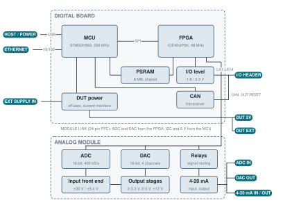
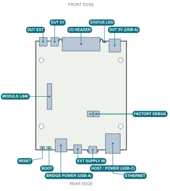
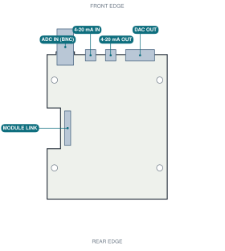
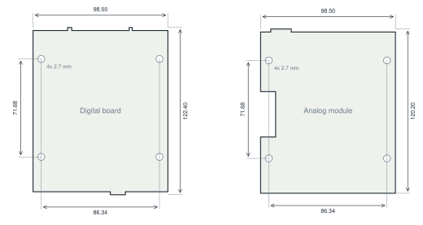

<!-- title: BenchPod datasheet -->
<!-- footer: BenchPod datasheet · Rev A · November 2026 · embeddedci.com -->

EmbeddedCI

# BenchPod

Hardware-in-the-loop test instrument for embedded boards

Datasheet · Rev A · November 2026 · Digital board v3r3 with analog module v3-r4

### Overview

BenchPod sits next to the embedded board under test (the DUT) and does what an engineer does at the bench: it powers the DUT, flashes its firmware, reads its console, and measures and drives its signals. Tests run on real hardware, started from a laptop, a CI pipeline or an AI agent, over Ethernet, USB or the EmbeddedCI cloud.

It is built from two stacked boards: a **digital board** (power, flashing, logic analyzer, network) and an **analog module** (ADC, DAC, 4-20 mA). It is professional lab equipment for electronics developers, supplied as a bare board assembly.

### Typical uses

- Flash and boot test in CI, asserting on the boot log
- Firmware tests that toggle, read and decode the DUT's pins
- Sensor emulation over I2C, GPS emulation over UART
- Recording a real analog signal and replaying it into the DUT
- Power cycling and current measurement of the DUT

### Key features

- **DUT power**: switched 5 V and external supply outputs, current monitoring
- **Flash and debug**: on-board CMSIS-DAP probe (SWD), works with OpenOCD targets
- **14-channel logic analyzer / GPIO** at 1.8 V or 3.3 V
- **Protocols**: UART, I2C (sensor emulation), SPI, CAN
- **16-bit ADC**, 400 kS/s, ±30 V, BNC input
- **16-bit DAC**, outputs 0-3.3 V, 0-5 V and ±12 V
- **4-20 mA** input and output
- **Network**: Ethernet, USB, optional Wi-Fi bridge, EmbeddedCI cloud
- **Software**: Python SDK with pytest, CLI, MCP server for AI agents, web app

## At a glance

| | |
|---|---|
| Power input | 5 V DC, USB-C, 0.26 A idle |
| DUT power | Switched 5 V (2 A) and external 2.7-20 V (3 A) outputs, current monitoring |
| Logic analyzer / GPIO | 14 channels, 1.8 V or 3.3 V, up to 12 MS/s, 48 MS/s change capture |
| Protocols | SWD (CMSIS-DAP), UART, SPI, I2C sensor emulation, GPS emulation, CAN |
| ADC | 16-bit, 400 kS/s, ±30 V, BNC |
| DAC | 16-bit, 0-3.3 V, 0-5 V and ±12 V outputs, up to 889 kS/s |
| Current loop | 4-20 mA input and two-wire 4-20 mA output |
| Network | Ethernet 10/100, USB, optional Wi-Fi bridge, EmbeddedCI cloud |
| Size | 98.6 x 122.5 mm footprint, two stacked boards |

## How it works

<figure>

<figcaption>Functional block diagram. Ports are shown with their names on the board edge.</figcaption>
</figure>

### Digital board

- **MCU** (STM32H563): runs the firmware. It handles the network (ETHERNET, the USB network adapter and the cloud connection) and executes the commands. It also switches and monitors DUT power, runs the CAN controller and drives DUT RESET. Over the MODULE LINK it sets the analog module's relays and reads its ID memory.
- **FPGA** (iCE40UP5K): every LA channel on the I/O HEADER goes straight to an FPGA pin, through a 330 Ω series resistor and an ESD clamp. No pin has a fixed function. The FPGA implements logic analyzer capture, GPIO, timed pulses, UART, SPI, the SWD debug probe, and I2C sensor and GPS emulation, on whichever channels the wiring profile assigns. It also drives the ADC and DAC on the analog module and the STATUS LED.
- **I/O level**: the FPGA's LA bank runs from a switched 1.8 V or 3.3 V supply. The channels are at the DUT's logic level directly, with no level shifters.
- **PSRAM** (8 MB): shared by the MCU and the FPGA. Deep captures stream into it, and recorded signals replay from it.
- **DUT power**: eFuses with current limits switch the DUT 5V and DUT EXT outputs. A monitor measures each output's current.

### Analog module

The analog module has no processor. The FPGA reads the ADC and writes the DAC over the MODULE LINK, and the MCU sets the relays over I2C.

- **ADC IN**: a divider, buffer and differential driver feed a 16-bit SAR ADC with a 4.096 V reference. A relay selects the ±30 V or the ±5.4 V range.
- **DAC OUT**: a quad 16-bit DAC with one channel per output: 0-3.3 V, 0-5 V, ±12 V, plus the channel for the 4-20 mA output.
- **4-20 mA**: the input is a 249 Ω sense resistor read by the ADC. The output is a two-wire loop transmitter set by the DAC.
- **Relays** route the inputs and loop the outputs back to the ADC, for self-test and calibration.
- **ID memory**: identifies the module to the firmware.

## Ports

### Digital board

<figure class="board">

<figcaption>Digital board, top view, front edge up.</figcaption>
</figure>

| Port | Connector | Function |
|---|---|---|
| HOST / POWER | USB-C | 5 V power input and USB connection to the computer (network adapter, console, firmware update) |
| ETHERNET | RJ45, 10/100 Mbit/s | Network connection to the LAN or the EmbeddedCI cloud |
| I/O HEADER | 2x13, 2.54 mm | 14 logic analyzer / GPIO channels, CAN, DUT reset, reference voltages |
| DUT 5V | 2-pin terminal block, 3.81 mm | Switched 5 V supply for the DUT |
| DUT 5V (USB-A) | USB-A | Same switched 5 V supply as DUT 5V, power only |
| EXT SUPPLY IN | 2-pin terminal block, 3.81 mm | External DUT supply input, 2.7-20 V |
| DUT EXT | 2-pin terminal block, 3.81 mm | Switched external supply for the DUT |
| BRIDGE POWER | USB-A | 5 V for the optional Wi-Fi bridge, power only |
| STATUS LED | RGB LED | Pod status |
| RESET, BOOT | Push buttons | Restart the pod; enter firmware update mode |
| MODULE LINK | 24-pin FFC | Connection to the analog module |
| FACTORY DEBUG | Two 2x2 footprints | Production use only |

### Analog module

The analog module stacks on top of the digital board, on the same mounting holes, with its front edge on the same side.

<figure class="board">

<figcaption>Analog module, top view, front edge up.</figcaption>
</figure>

| Port | Connector | Function |
|---|---|---|
| ADC IN | BNC | Analog input, ±30 V |
| DAC OUT | 6-pin terminal block, 3.81 mm | Three analog outputs: 0-3.3 V, 0-5 V, ±12 V |
| 4-20 mA IN | 2-pin terminal block, 3.81 mm | Current loop measurement input |
| 4-20 mA OUT | 2-pin terminal block, 3.81 mm | Two-wire 4-20 mA transmitter output |
| MODULE LINK | 24-pin FFC | Connection to the digital board |

## Pin assignments

### I/O HEADER

The I/O HEADER is a keyed, shrouded 2x13 right-angle header with 2.54 mm pitch, on the front edge of the digital board. A triangle on the shroud marks pin 1. Odd pins are in one row and even pins in the other.

| Pin | Signal | Pin | Signal |
|---|---|---|---|
| 1 | LA1 | 2 | LA2 |
| 3 | LA3 | 4 | LA4 |
| 5 | LA5 | 6 | LA6 |
| 7 | LA7 | 8 | LA8 |
| 9 | LA9 | 10 | LA10 |
| 11 | LA11 | 12 | LA12 |
| 13 | LA13 | 14 | LA14 |

| Pin | Signal | Pin | Signal |
|---|---|---|---|
| 15 | GND | 16 | GND |
| 17 | +3.3 V out | 18 | +1.8 V out |
| 19 | CAN high | 20 | CAN low |
| 21 | LA_REF | 22 | DUT RESET |
| 23 | GND | 24 | GND |
| 25 | GND | 26 | GND |

- **LA1-LA14**: logic analyzer and GPIO channels. Any channel can carry UART, SWD, SPI, I2C or a GPIO; the wiring profile in the web app records which signal is on which channel.
- **LA_REF**: reference output at the selected I/O voltage (1.8 V or 3.3 V).
- **DUT RESET**: dedicated reset line to the DUT, used when flashing and by reset commands.
- **CAN high / CAN low**: CAN bus through an on-board transceiver, with a switchable termination.

### Terminal blocks

All terminal blocks are pluggable, 3.81 mm pitch. Pins are listed left to right, looking at the connector from outside the board.

| Port | Left to right |
|---|---|
| DUT EXT | + , GND |
| DUT 5V | + , GND |
| EXT SUPPLY IN | + (2.7-20 V), GND |
| 4-20 mA IN | + (input), GND |
| 4-20 mA OUT | + (to loop supply plus), - (loop return) |
| DAC OUT | 0-3.3 V, GND, 0-5 V, GND, ±12 V, GND |

The 4-20 mA OUT minus terminal is not ground. The loop needs its own floating supply, and nothing in the loop may connect to the pod's ground.

## Electrical characteristics

Typical values at 25 °C, with the pod powered from a 5 V USB-C supply.

### Power

| Parameter | Value |
|---|---|
| Supply input | 5 V DC via HOST / POWER (USB-C), protected by an eFuse |
| Current consumption | 0.26 A idle; under 0.5 A with all functions running (DUT power not included) |
| DUT 5V output | 5 V from the input, switched, current limit about 2 A, shared with DUT 5V (USB-A) |
| EXT SUPPLY IN | 2.7-20 V DC, for example 3.3 V, 12 V or 19 V. Below about 2.5 V the output stays off, so it cannot pass 1.8 V. Above about 21.8 V the output switches off |
| DUT EXT output | Switched EXT SUPPLY IN, current limit about 3 A |
| DUT current monitoring | On both DUT outputs: about 83 µA resolution on DUT 5V, 125 µA on DUT EXT |
| BRIDGE POWER output | 5 V, current limit about 1 A |

### Logic analyzer and GPIO

| Parameter | Value |
|---|---|
| Channels | 14 |
| I/O voltage | 1.8 V or 3.3 V, selectable |
| Channel protection | 330 Ω series resistor and ESD clamp on each channel |
| Pull resistors (switchable, 3.3 V I/O) | LA1-LA2 4.7 kΩ up; LA3-LA4 2.2 kΩ up; LA5-LA6 10 kΩ up; LA7-LA8 10 kΩ down; LA9-LA14 none |
| Sample rate | Up to 12 MS/s; change capture up to 48 MS/s (20.8 ns resolution) |
| Capture depth | Up to 4 M samples (8 MB PSRAM) |
| GPIO pulses | FPGA-timed, 4 µs to 65.5 ms wide |

### Protocols

| Protocol | Value |
|---|---|
| SWD | On-board CMSIS-DAP probe, clock up to 6 MHz, dedicated DUT RESET line |
| UART | Default 115200 baud, interactive console and boot log capture |
| SPI | Master, modes 0-3, up to 6 MHz |
| I2C | Sensor emulation: BMP280, BME280, SHT4x, MPU-6050 |
| GPS | NMEA 0183 emulation over UART, up to 10 Hz |
| CAN | Classic CAN, 10 kbit/s to 1 Mbit/s, switchable termination |

### ADC IN

| Parameter | Value |
|---|---|
| Resolution | 16-bit |
| Sample rate | Up to 400 kS/s |
| Input range | ±30 V (about 1 mV per count); low range ±5.4 V |
| Input impedance | About 1 MΩ (±30 V range), 1.8 MΩ (low range) |
| Capture depth | 32 k samples; deep capture up to 2 M samples (about 5 s at 400 kS/s) |
| Connector | BNC |

### DAC OUT

| Parameter | Value |
|---|---|
| Resolution | 16-bit, one DAC channel per output |
| Outputs | 0-3.3 V, 0-5 V, ±12 V |
| Output impedance | 49.9 Ω series resistor on each output |
| Update rate | Up to 889 kS/s |
| Waveforms | Sine, square, sawtooth, arbitrary; replay of recorded signals up to 4 M samples |

### 4-20 mA

| Parameter | Value |
|---|---|
| 4-20 mA IN | 249 Ω sense resistor (0.1 %), measured by the ADC |
| 4-20 mA OUT | Two-wire transmitter, about 4 to 20 mA, 0.25 µA steps |
| Loop supply for 4-20 mA OUT | External, floating, 30 V maximum |

### Processing and network

| Parameter | Value |
|---|---|
| Processor | STM32H563 Arm Cortex-M33, 250 MHz, 1 MB flash |
| FPGA | Lattice iCE40UP5K, captures and signal generation |
| Memory | 8 MB PSRAM for deep captures and replay |
| ETHERNET | 10/100 Mbit/s, RJ45 with magnetics, no PoE |
| USB | USB 2.0 full speed device: network adapter, console, firmware update |
| Cloud | Secure WebSocket (TLS) connection to embeddedci.com |
| Firmware update | Over the network or the cloud (signed, checksummed images) or over USB |

### STATUS LED

| Color | Meaning |
|---|---|
| Three green blinks | Started up normally |
| Green | DUT power on |
| Short cyan flash | A command ran |
| Blue | Deep capture or replay running |
| Magenta | Firmware update in progress |
| Blinking red | DUT power fault (current limit or overvoltage) |
| Solid red | Self-test failed, or safe mode |
| Off | Idle |

## Mechanical

<figure>

<figcaption>Board outlines and mounting holes, top view, dimensions in mm. The analog module stacks on the digital board on the same four mounting holes.</figcaption>
</figure>

| Parameter | Value |
|---|---|
| Digital board | 98.55 x 122.45 mm including connector overhang, 1.6 mm, 4 layers |
| Analog module | 98.60 x 120.30 mm including connector overhang, 1.6 mm, 4 layers |
| Mounting holes | 4x M2.5 (2.7 mm), 86.34 x 71.69 mm spacing, same on both boards |
| Board link | 24-pin FFC, 1.0 mm pitch |
| Enclosure (optional) | Hammond 1455N1201BK, 120 x 103 x 53 mm, with custom end panels |

## Wi-Fi bridge (optional accessory)

The Wi-Fi bridge connects BenchPod to a Wi-Fi network. It plugs into the pod's ETHERNET port with a patch cord and takes 5 V from the pod's BRIDGE POWER port. The pod reaches the network through the bridge as if it were wired.

| Parameter | Value |
|---|---|
| Radio module | Espressif ESP32-WROOM-32E-N8, module antenna |
| Radio | Wi-Fi 2.4 GHz |
| Size | About 70 x 52 mm, bare board |
| Firmware | Updated through the pod, signed images |

## Software

| Tool | Use |
|---|---|
| Web app (embeddedci.com) | Live capture, generator, terminal, flashing and wiring setup in the browser |
| Python SDK | `pip install embeddedci`: drive the pod from Python, with pytest fixtures |
| CLI | `benchpod`: discover, flash, capture, firmware update from the command line |
| MCP server | Lets AI agents (Claude, Codex and others) drive the pod |
| GitHub Action | Run hardware tests from a CI workflow through the EmbeddedCI cloud |

Documentation: [embeddedci.com/docs](https://embeddedci.com/docs/start-here)

## Information for test labs

The EMC test plan, a separate document, describes the operating mode, monitoring and setup.

### Port classification

| Port | Type | Notes |
|---|---|---|
| HOST / POWER | DC power port and signal port | 5 V in; USB 2.0 full speed |
| ETHERNET | Wired network port | 10/100 Mbit/s, no PoE |
| EXT SUPPLY IN | DC power port (input) | 2.7-20 V |
| DUT 5V, DUT 5V (USB-A), DUT EXT | DC power ports (output) | To the DUT |
| BRIDGE POWER | DC power port (output) | To the Wi-Fi bridge |
| I/O HEADER | Signal port | Logic level 1.8 / 3.3 V, CAN |
| ADC IN, DAC OUT, 4-20 mA IN, 4-20 mA OUT | Signal ports | Analog, ±30 V maximum |

There is no mains port: BenchPod runs from 5 V USB-C. The manual states a maximum cable length of 3 m for every port except ETHERNET.

### Internal frequencies

| Source | Frequency |
|---|---|
| MCU core (PLL, VCO 500 MHz) | 250 MHz |
| MCU crystal, Ethernet PHY crystal | 25 MHz |
| Ethernet RMII reference | 50 MHz |
| USB | 48 MHz |
| MCU to PSRAM | 50 MHz |
| FPGA oscillator (no PLL) | 48 MHz; logic mostly at 24 MHz |
| ADC / DAC serial clocks | 12 MHz / 24 MHz |

Highest internal frequency: 250 MHz (500 MHz PLL VCO inside the MCU).

### Switching converters

| Part | Board | Function |
|---|---|---|
| TPS62130A | Digital board | 5 V to 3.3 V buck |
| TLV61046A | Analog module | Boost for the analog supply |
| TPS65131 | Analog module | ±14 V rails |
| LM27761, LM7705 | Analog module | Negative charge pumps |
| TLV62569 | Wi-Fi bridge | 5 V to 3.3 V buck |

## Compliance

In progress: EMC testing to FCC Part 15B Class B and EN 55032 / EN 55035, and the RoHS declaration. Current status: [embeddedci.com/compliance](https://www.embeddedci.com/compliance).

IN4IT LLC, d/b/a EmbeddedCI · hello@embeddedci.com · embeddedci.com. Specifications are subject to change without notice.

